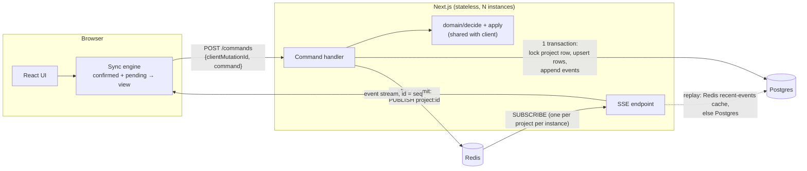

# Taskflow: real-time collaborative task management

A Next.js (App Router) full-stack app built on Postgres and Redis. There is no
managed real-time database. Every change is an **event** in an append-only,
per-project log. Clients receive those events (not projects) over
**Server-Sent Events**, and they all apply them in the same order, so every
client ends up in the same state.

```bash
docker compose up --build          # app on http://localhost:3000 (runs migrations on start)
docker compose exec app npm run db:seed   # optional: demo project + a 10,000-task project
```

Open two browser windows (or one normal and one private) with different display
names to see collaboration live. API docs are at **/docs** (Swagger UI) and
**/api/openapi.json**.

---

## Contents

1. [What's implemented](#whats-implemented)
2. [Architecture](#architecture)
3. [How sync works](#how-sync-works)
4. [Consistency model](#consistency-model)
5. [Scaling over time](#scaling-over-time)
6. [Tradeoffs](#tradeoffs)
7. [Technology choices](#technology-choices)
8. [Development](#development)
9. [Project layout](#project-layout)

---

## What's implemented

**Core requirements**

| Requirement | How |
| --- | --- |
| Multiple projects | Project list with live create/rename/delete (lobby SSE stream) |
| Add / update / delete tasks | Title, status, priority, description, assignees, tags, custom fields. Delete is a soft delete, so it can be undone |
| Dependencies + status transitions | Workflow `todo → in_progress → in_review → done` (can reopen). A task can't enter review/done until its dependencies are done. Cycles are rejected |
| Real-time comment threads | Comment events stream live; threads load lazily per task |
| Near-real-time sync | SSE push. Commit → other client p95 ≈ 35 ms with 200 listeners ([results](load/RESULTS.md)) |
| Consistency across clients | One ordered log per project, and one deterministic reducer shared by server and clients ([below](#consistency-model)) |
| No Firebase/Supabase | Postgres + Redis + SSE only |
| 2 MB+ projects / don't resend projects | Initial load is paged (keyset). After that only events of ~300 B each are sent. A 10k-task / ~7 MB project is in the seed |

**Bonus points**

| Bonus | Where |
| --- | --- |
| Undo / redo | Each change records its inverse command. Undo sends the inverse as a normal command (⌘Z / ⇧⌘Z), so other clients see it too: `src/domain/undo.ts` |
| CRDT-inspired approach | Per-field patches (last-writer-wins per field, not per task), add/remove set operations for tags and assignees, and a server-assigned total order: `src/domain/apply.ts` |
| Event-based backend | Append-only `events` table with seq as part of the primary key, plus Redis pub/sub. The DB tables are a projection of the log (an integration test replays the log and checks it matches the tables) |
| Clear domain model | `src/domain/`: pure TypeScript, no I/O. `decide(state, command) → events`, `apply(state, events) → state` |
| Type-safe API contract | zod schemas in `src/contract/` validate requests on the server, provide TS types to the client, and generate the OpenAPI doc. Route ↔ response types are checked via `ApiResponse<"POST /api/...">` |
| Optimistic UI with rollback | Changes show instantly. Rejected ones are rolled back with a toast. Remote events are applied first and pending local changes re-applied on top: `src/client/store.ts` |
| DB transactions | Each command: lock project row → load → validate → upsert → append event, all in one transaction |
| Caching | Redis keeps each project's last 500 events, so reconnects replay without hitting Postgres. Fan-out is in memory per process (one Redis subscription per project per instance) |
| Rate limiting + backpressure | Redis token bucket per user (429 + `Retry-After`). Each SSE connection has a capped queue: slow clients are dropped and resume from `Last-Event-ID`. Clients far behind get `resync` and reload |

**Extended challenges**

- **Option 1, Performance & scale:**
  - virtual scrolling (list and every board column; 10k tasks render about 25 DOM rows),
  - cursor pagination,
  - indexing strategy,
  - load tests with scripts and [results](load/RESULTS.md).
- **Option 3, Developer experience:**
  - unit tests (domain), integration tests (real Postgres/Redis), and Playwright e2e tests (two browsers collaborating),
  - GitHub Actions CI,
  - OpenAPI/Swagger,
  - Drizzle migrations and a seed script.
- **Option 2, partly:**
  - presence (who's in the project and which task they have open),
  - a live activity feed,
  - @mentions with notifications.
- **Option 4, partly:** a Kanban board with drag and drop. Dropping a card is validated as a status transition.

---

## Architecture



The shared domain layer in `src/domain/` is what makes the design hold
together:

- `decide(context, command)` validates an intent and returns events, or throws
  a `DomainError` (blocked, cycle, invalid_transition…).
- `applyEvents(state, events)` is the only reducer. The server uses it to
  compute the rows to write. The client uses it for confirmed state and for
  optimistic predictions.

Since both sides run the same code, the server's rows and the clients' state
can't drift apart, and the client can reject most invalid changes before
making a request.

### Write path (`src/server/commands.ts`)

1. `SELECT … FROM projects WHERE id = ? FOR UPDATE`. This locks the project
   row and acts as a per-project sequencer: concurrent writers on the same
   project queue up, and writers on different projects don't block each other.
2. Idempotency check: if this `clientMutationId` was already applied, return
   the original events.
3. Load **only** the rows the command needs: the target task, its dependencies,
   and for dependency changes the reachable subgraph via a recursive CTE.
   Never the whole project.
4. `decide()` → events, numbered `version+1…`.
5. `applyEvents()` on those rows, then upsert the changed rows, update
   `projects.version`, and insert the events. Commit.
6. Publish each event to Redis and append it to the recent-events cache.

### Read and subscribe path

- `GET /projects/:id` returns metadata and `version`. The client then opens
  `GET /projects/:id/stream?since=version` **before** loading tasks, and
  buffers the events it receives.
- `GET /projects/:id/tasks?cursor=…&limit=1000` uses keyset pagination over
  `(project_id, id)`. Pages render as they arrive (the progress bar shows the
  count).
- Once all pages are loaded, the buffered events are applied. Each task stores
  the `seq` of the last event that changed it, so events already included in a
  page are skipped. This makes "load pages while events keep arriving"
  race-free without a snapshot transaction.
- Comments are loaded only when a task is opened.

---

## How sync works

**Server → client: SSE.**

- Each event goes out as `id: <seq>` plus JSON. When the connection drops, the
  browser's `EventSource` reconnects automatically and sends `Last-Event-ID`,
  so the server replays exactly what was missed: from the Redis cache, or from
  Postgres if the cache doesn't cover it.
- The server guarantees **in-order, gap-free** delivery. Redis pub/sub can
  deliver out of order (concurrent publishers) or drop messages, so events
  arriving early are held briefly and gaps are filled from the cache or DB.
- If a client is more than 1,000 events behind, it gets a `resync` event and
  reloads the project instead.

**Client → server: one command endpoint.**

- `POST /api/projects/:id/commands` takes `{ clientMutationId, command }`.
- The client sends commands one at a time, in order. This preserves causal
  order (create before update) with no reordering logic on the server.
- Network or 5xx errors are retried with backoff using the same
  `clientMutationId`. That is safe because the server is idempotent per
  mutation id.
- 429 waits for `Retry-After`. Other 4xx responses roll the change back.

**Optimistic UI** (`src/client/store.ts`):

```
view = applyEvents(confirmed, pending.events with provisional seqs)
```

- A local command is checked with `decide()` against `view`. If valid, it is
  added to `pending` and shows immediately.
- When its event arrives over SSE (matched by `clientMutationId`), it is
  dropped from `pending`. It's now part of `confirmed`, so the screen doesn't
  change.
- If the server rejects it, it is removed from `pending`, and `view` recomputes
  without it: that's the rollback.
- Remote events update `confirmed`, and `pending` is re-applied on top: a
  simple rebase.
- If a change was accepted but hasn't come back over SSE within 5 s, the client
  reconnects to force a replay. This covers a missed Redis publish.

**Presence** is a Redis hash per project with a 30 s TTL. Clients send a
heartbeat every 10 s and whenever they open a task, and the server pushes the
list on the same SSE stream.

---

## Consistency model

- **One total order per project.** Postgres assigns each event a
  `seq`. Every client applies the same events in the same order with the same
  pure reducer, so they all end up in the same state. Locally that state is
  `confirmed`, with pending changes shown on top.
- **Merge granularity (the CRDT-inspired part).**
  - Commands carry per-field patches, not whole tasks. If Alice changes the
    title while Bob changes the priority, both changes survive.
  - Tags and assignees use add/remove operations, so concurrent additions
    merge.
  - Custom fields merge key by key.
  - Only edits to the *same field* conflict, and the later commit wins.
- **Invariants are checked on the server** inside the transaction, against
  current data: dependency cycles, status workflow, "blocked" rules, comment
  ownership. Two concurrent changes that are each valid alone but together
  would form a cycle can't both commit, because the project lock serializes
  them.
- **Undo never rewrites history.** It's a new command computed from current
  state, so it's just another event for everyone else. If the undo is no longer
  valid (e.g. someone else deleted the task), it's rejected like any other
  command.

## Scaling over time

What's built (one region, N stateless app instances) and the next steps:

1. **More app instances.** The app holds no state. Redis pub/sub fans events
   out across instances, and each instance has one Redis subscription per
   active project shared by its SSE connections. SSE connections are long-lived
   HTTP requests, so the load balancer needs idle timeouts above 15 s
   (heartbeats are every 15 s).
2. **Reads.** Send task pages, comment threads and replays to Postgres read
   replicas. Replays are already mostly served from Redis.
3. **Large projects.**
   - Initial load is already paged and proportional to page size.
   - Next: send only the visible subset (server-side filtering by status/tag
     using the existing partial and GIN indexes), and cache page snapshots by
     `(project, version)` in Redis or a CDN.
   - Snapshot plus log tail: keep a compacted snapshot every N events, so
     clients that were offline a long time load the snapshot and replay the
     tail.
4. **Event log growth.** Partition `events` by project hash or time, archive
   old partitions to object storage, and keep recent events hot.
5. **Write throughput.**
   - The per-project row lock limits throughput *per project* (≈200 writes/s
     measured on a laptop, with no failures). Different projects scale
     independently.
   - If one project ever needs more, replace the row lock with a single-writer
     actor per project (sharded by project id), or batch several commands per
     transaction.
6. **Fan-out at large scale.** Replace Redis pub/sub with Redis Streams, NATS
   or Kafka. That gives durable, partitioned delivery and lets an SSE gateway
   tier scale apart from the API tier.

## Tradeoffs

- **SSE + POST instead of WebSockets.**
  - Works in plain App Router route handlers with no custom server, and gets
    reconnect and `Last-Event-ID` resume for free.
  - Downside: client→server traffic is separate HTTP requests. That's fine for
    commands and presence heartbeats, but too slow for live cursors or
    keystroke-level shared editing, which would need WebSockets.
- **Server-ordered log instead of a full CRDT.**
  - Easier to reason about, makes business rules enforceable (cycles,
    workflow), and gives every client the same history.
  - Downside: edits need the server (no offline-first). Concurrent edits to the
    *same* text field are last-writer-wins, not merged character by character.
    The next step would be Yjs for the description field only.
- **Per-project row lock.** Simple and correct (gap-free seq, serialized
  invariant checks) at the cost of throughput per project; see scaling point 5.
- **Read model and log written in one transaction.** No eventual-consistency
  lag between the event log and the tables, but writes cost more than appending
  the event alone.
- **Publish after commit, without an outbox table.** A crash between commit
  and publish would leave an event in the log but not pushed. Clients recover:
  they detect the gap, or the 5 s watchdog fires, and replay from Postgres. A
  transactional outbox would make delivery strictly reliable.
- **Client loads all tasks.** Simple, and makes filtering, search, the board
  and the dependency picker instant for 10k+ tasks. At around 100k tasks I'd
  switch to server-side filtered windows.
- **Identity is a display-name cookie.** No auth, on purpose: it's outside the
  brief, and the design doesn't depend on it (`src/server/session.ts` is the
  only place to change). Any user can access any project.
- **Soft delete.** Keeps comments and dependency edges so delete can be undone.
  Deleted tasks don't block anything and are hidden.

## Technology choices

| Choice | Why |
| --- | --- |
| **Next.js 16 App Router** (route handlers) | Preferred stack. One TypeScript codebase, so the domain logic and the contract are shared, not duplicated |
| **Postgres** | Transactions, row locks for sequencing, recursive CTEs for graph checks, partial and GIN indexes. The event log and the tables share one transaction |
| **Redis** | Pub/sub across instances, recent-events cache, atomic token bucket in Lua, presence with TTL |
| **SSE** | Server→client push that works through proxies and HTTP/2, with automatic resume built in |
| **Drizzle ORM** | Typed schema, SQL-first queries, generated SQL migrations committed to the repo |
| **zod** | One schema per request type → runtime validation, TS types and OpenAPI |
| **zustand** | Small store outside React, so the sync engine is plain TS. Components subscribe with fine-grained selectors |
| **TanStack Virtual** | Virtualizes the list and each board column |
| **Vitest / Playwright / k6** | Unit and integration / two-browser e2e / load |

---

## Development

Requirements: Node 24, Docker.

```bash
cp .env.example .env
docker compose up -d db redis
npm install
npm run db:migrate
npm run db:seed        # optional
npm run dev            # http://localhost:3000
```

| Command | |
| --- | --- |
| `npm test` | Unit tests (domain) + integration tests (needs db/redis running) |
| `npm run test:e2e` | Playwright: two browsers collaborating (starts a dev server on :3100) |
| `npm run typecheck` / `npm run lint` | |
| `npm run db:generate` | New migration from `src/server/db/schema.ts` |
| `npx tsx load/fanout.ts <projectId>` | SSE fan-out latency test |
| `docker run --rm -i -e PROJECT_ID=<id> -e BASE_URL=http://host.docker.internal:3000 grafana/k6 run - < load/k6-api.js` | HTTP load test |

CI (`.github/workflows/ci.yml`) runs typecheck, lint, unit and integration
tests against Postgres/Redis service containers, the production build,
Playwright e2e, and a Docker image build.

## Project layout

Suggested reading order for onboarding: `domain` → `contract` → `server/commands.ts` → `server/sse.ts` → `client/store.ts`.

| Path | What it is |
| --- | --- |
| `src/domain/` | Business logic, with no I/O; both server and client run it. |
| ├─ `types.ts`, `events.ts` | The data model (Project, Task, Comment) and every event type |
| ├─ `rules.ts` | Status workflow, "blocked" rule, dependency cycle detection |
| ├─ `decide.ts` | Command → events, or a `DomainError` when a rule is broken |
| ├─ `apply.ts` | The only reducer: applies events to state |
| └─ `undo.ts` | Computes the inverse command for undo/redo |
| `src/contract/` | The API contract: `schemas.ts` (zod request validation), `api.ts` (response types per route), `openapi.ts` (generated docs) |
| `src/server/` | Backend code, called by the route handlers. |
| ├─ `commands.ts` | **The write path:** lock → validate → persist → append event → publish |
| ├─ `sse.ts` | Event streams: ordered, gap-free delivery, replay, backpressure |
| ├─ `redis.ts` | Pub/sub fan-out, recent-events cache, presence, rate limiter |
| ├─ `queries.ts` | Read endpoints (paginated tasks, comments, activity) |
| └─ `db/schema.ts` | Tables and indexes (Drizzle); migrations are generated from this |
| `src/client/store.ts` | **The client sync engine:** confirmed/pending/view state, optimistic updates, rollback, undo, SSE connection |
| `src/app/api/` | Thin route handlers (parse → call `server/` → respond). `projects/[id]/commands` is the only write endpoint |
| `src/components/` | UI: `ProjectView` (page shell), `TaskList` / `Board` (virtualized), `TaskPanel` (task details + comments) |
| `drizzle/` | Generated SQL migrations (don't edit; run `npm run db:generate`) |
| `scripts/` | `migrate.ts`, `seed.ts` |
| `tests/` | `unit/` (domain), `integration/` (write path on real Postgres/Redis), `e2e/` (two-browser Playwright) |
| `load/` | Load-test scripts (k6 and SSE fan-out) and `RESULTS.md` |
