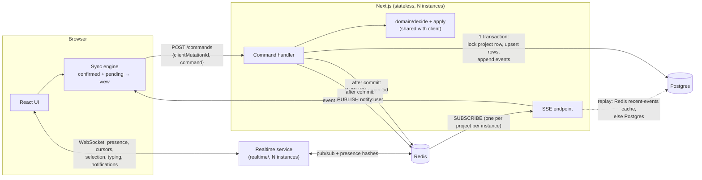

# Taskflow: real-time collaborative task management

A Next.js (App Router) full-stack app built on Postgres and Redis. There is no
managed real-time database. Every change is an **event** in an append-only,
per-project log. Clients receive those events (not projects) over
**Server-Sent Events**, and they all apply them in the same order, so every
client ends up in the same state. Tasks and projects load as infinite-scroll
feeds sorted by last updated, and are cached in IndexedDB, so the app keeps
working offline and catches up from a Redis change index when it reconnects.
A small TypeScript **WebSocket service** adds live collaboration: presence,
cursors pinned to tasks, shared selection, typing indicators and instant
notifications.

```bash
docker compose up --build          # app on :3000 (runs migrations on start), WebSocket service on :3001
docker compose exec app npm run db:seed   # optional: demo project + a 10,000-task project
```

Open two browser windows (or one normal and one private) with different display
names to see collaboration live. API docs are at **/docs** (Swagger UI) and
**/api/openapi.json**.

---

## Contents

1. [What's implemented](#whats-implemented)
2. [Architecture](#architecture)
3. [How sync works](#how-sync-works)
   - [Offline and catch-up](#offline-and-catch-up)
4. [Consistency model](#consistency-model)
5. [Scaling over time](#scaling-over-time)
6. [Tradeoffs](#tradeoffs)
7. [Technology choices](#technology-choices)
8. [Development](#development)
9. [Project layout](#project-layout)

---

## What's implemented

**Core requirements**

| Requirement | How |
| --- | --- |
| Multiple projects | Project list with live create/rename/delete (lobby SSE stream) |
| Add / update / delete tasks | Title, status, priority, description, assignees, tags, custom fields. Delete is a soft delete, so it can be undone |
| Dependencies + status transitions | Workflow `todo → in_progress → in_review → done` (can reopen). A task can't enter review/done until its dependencies are done. Cycles are rejected |
| Real-time comment threads | Comment events stream live; threads load lazily per task |
| Near-real-time sync | SSE push. Commit → other client p95 ≈ 35 ms with 200 listeners ([results](load/RESULTS.md)) |
| Consistency across clients | One ordered log per project, and one deterministic reducer shared by server and clients ([below](#consistency-model)) |
| No Firebase/Supabase | Postgres + Redis + SSE only |
| 2 MB+ projects / don't resend projects | Nothing loads a whole project. Tasks come in infinite-scroll pages of 50 (keyset cursor). After that only events of ~300 B each are sent, and a returning client gets only the tasks that changed. A 10k-task / ~7 MB project is in the seed |

**Bonus points**

| Bonus | Where |
| --- | --- |
| Undo / redo | Each change records its inverse command. Undo sends the inverse as a normal command (⌘Z / ⇧⌘Z), so other clients see it too: `src/domain/undo.ts` |
| CRDT-inspired approach | Per-field patches (last-writer-wins per field, not per task), add/remove set operations for tags and assignees, and a server-assigned total order: `src/domain/apply.ts` |
| Event-based backend | Append-only `events` table with seq as part of the primary key, plus Redis pub/sub. The DB tables are a projection of the log (an integration test replays the log and checks it matches the tables) |
| Clear domain model | `src/domain/`: pure TypeScript, no I/O. `decide(state, command) → events`, `apply(state, events) → state` |
| Type-safe API contract | zod schemas in `src/contract/` validate requests on the server, provide TS types to the client, and generate the OpenAPI doc. Route ↔ response types are checked via `ApiResponse<"POST /api/...">` |
| Optimistic UI with rollback | Changes show instantly. Rejected ones are rolled back with a toast. Remote events are applied first and pending local changes re-applied on top: `src/client/store.ts` |
| DB transactions | Each command: lock project row → load → validate → upsert → append event, all in one transaction |
| Caching | Server: Redis keeps each project's last 500 events (fast reconnect replay) and a sorted-set change index per project (fast catch-up). Fan-out is in memory per process (one Redis subscription per project per instance). Client: IndexedDB copy of every task and project it has seen, plus unsent edits |
| Rate limiting + backpressure | Redis token bucket per user (429 + `Retry-After`). Each SSE connection has a capped queue: slow clients are dropped and resume from `Last-Event-ID`. Clients far behind get `resync` and catch up with changed rows instead of a replay |

**Extended challenges**

- **Option 1, Performance & scale:**
  - infinite scroll with TanStack Query, sorted by last updated, with a keyset cursor on `(updated_at, id)`; each board column is its own feed,
  - virtual scrolling (list and every board column; about 25 DOM rows however many pages are loaded),
  - server-side search, filters and counts (trigram index for title search),
  - indexing strategy,
  - load tests with scripts and [results](load/RESULTS.md).
- **Option 3, Developer experience:**
  - unit tests (domain), integration tests (real Postgres/Redis), and Playwright e2e tests (two browsers collaborating),
  - GitHub Actions CI,
  - OpenAPI/Swagger,
  - Drizzle migrations and a seed script.
- **Option 2, Advanced collaboration:**
  - presence: who's in each project (shown on the project list too) and which task they have open. It's tied to the WebSocket connection, so joins and leaves show instantly,
  - live cursors pinned to tasks, plus shared selection: a colored outline on the task someone has open, "bob is editing…" on fields, "bob is typing…" in comments,
  - shared live editing of task descriptions: several people type in the same description at once, with everyone's named caret shown ([how](#shared-description-editing)),
  - a live activity feed, plus notifications: a bell with unread count across all projects, delivered instantly,
  - @mentions with notifications, detected on the server and saved, so you see them even if you were offline. Assignment, comments and status changes on your tasks notify you too.
- **Option 4, partly:**
  - a Kanban board with drag and drop. Dropping a card is validated as a status transition.
  - offline support: tasks, projects and unsent edits are kept in IndexedDB, and a service worker caches the app shell so the app opens without a network. Edits made offline sync on reconnect, and conflicting ones are rolled back with a message ([how](#offline-and-catch-up)).

---

## Architecture



There are two real-time channels, each with a clear job:

| | SSE (Next.js) | WebSocket (`realtime/`) |
| --- | --- | --- |
| Carries | Durable changes: the event log | Short-lived signals: presence, cursors, selection, typing. Also forwards notifications |
| Delivery | Ordered, gap-free, resumable (`Last-Event-ID`) | Latest-wins. Losing a cursor frame doesn't matter |
| Direction | Server → client (writes are POST commands) | Both ways, high frequency (cursors ~20/s per user) |
| State | Postgres (source of truth) + Redis cache | Redis only. Nothing in it needs to survive |

The shared domain layer in `src/domain/` is what makes the design hold
together:

- `decide(context, command)` validates an intent and returns events, or throws
  a `DomainError` (blocked, cycle, invalid_transition…).
- `applyEvents(state, events)` is the only reducer. The server uses it to
  compute the rows to write. The client uses it for confirmed state and for
  optimistic predictions.

Since both sides run the same code, the server's rows and the clients' state
can't drift apart, and the client can reject most invalid changes before
making a request.

### Write path (`src/server/commands.ts`)

1. `SELECT … FROM projects WHERE id = ? FOR UPDATE`. This locks the project
   row and acts as a per-project sequencer: concurrent writers on the same
   project queue up, and writers on different projects don't block each other.
2. Idempotency check: if this `clientMutationId` was already applied, return
   the original events.
3. Load **only** the rows the command needs: the target task, its dependencies,
   and for dependency changes the reachable subgraph via a recursive CTE.
   Never the whole project.
4. `decide()` → events, numbered `version+1…`.
5. `applyEvents()` on those rows, then upsert the changed rows, update
   `projects.version`, and insert the events. Commit.
6. Publish each event to Redis and append it to the recent-events cache.

### Read and subscribe path

- **Open a project:** render the IndexedDB copy if there is one, then catch up
  ([below](#offline-and-catch-up)), then open
  `GET /projects/:id/stream?since=<version>`.
- **Feeds** (`src/client/feeds.ts`): `GET /projects/:id/tasks?cursor=…&status=…&q=…`
  returns 50 tasks, most recently updated first, using keyset pagination on
  `(updated_at, id)` (index `tasks_project_updated_idx`). TanStack Query's
  `useInfiniteQuery` fetches the next page when the virtualized list is about
  10 rows from the end. Page rows go into the sync store, and a feed is just an
  ordered list of ids.
- **Frozen order.** Rows update in place, but changes by others don't reorder
  the list. A pill counts them ("3 updated · show"), and clicking it refetches
  from the top. Your own new tasks are pinned to the top.
- **Events for tasks not loaded yet** are held, and the task's row is fetched
  by id (batched). Each task stores the `seq` of the last event that changed
  it, so held events already reflected in the row are skipped. Loading pages
  while events keep arriving is race-free without a snapshot transaction.
- Comments load only when a task is opened. Dependencies of visible tasks are
  fetched on demand, for the "blocked" badge.

---

## How sync works

**Server → client: SSE.**

- Each event goes out as `id: <seq>` plus JSON. When the connection drops, the
  browser's `EventSource` reconnects automatically and sends `Last-Event-ID`,
  so the server replays exactly what was missed: from the Redis cache, or from
  Postgres if the cache doesn't cover it.
- The server guarantees **in-order, gap-free** delivery. Redis pub/sub can
  deliver out of order (concurrent publishers) or drop messages, so events
  arriving early are held briefly and gaps are filled from the cache or DB.
- If a client is more than 1,000 events behind, it gets a `resync` event and
  catches up with changed rows instead (next section).

**Client → server: one command endpoint.**

- `POST /api/projects/:id/commands` takes `{ clientMutationId, command }`.
- The client sends commands one at a time, in order. This preserves causal
  order (create before update) with no reordering logic on the server.
- Network or 5xx errors are retried with backoff using the same
  `clientMutationId`. That is safe because the server is idempotent per
  mutation id.
- 429 waits for `Retry-After`. Other 4xx responses roll the change back.

**Optimistic UI** (`src/client/store.ts`):

```
view = applyEvents(confirmed, pending.events with provisional seqs)
```

- A local command is checked with `decide()` against `view`. If valid, it is
  added to `pending` and shows immediately.
- When its event arrives over SSE (matched by `clientMutationId`), it is
  dropped from `pending`. It's now part of `confirmed`, so the screen doesn't
  change.
- If the server rejects it, it is removed from `pending`, and `view` recomputes
  without it: that's the rollback.
- Remote events update `confirmed`, and `pending` is re-applied on top: a
  simple rebase.
- If a change was accepted but hasn't come back over SSE within 5 s, the client
  reconnects to force a replay. This covers a missed Redis publish.

### Live collaboration (WebSocket service)

`realtime/server.ts` is a small Node service using the `ws` package. It never
touches Postgres. Next.js route handlers can't hold WebSocket connections, so it
runs alongside the app; it's TypeScript so it shares the message contract
(`src/contract/realtime.ts`, zod) with the browser.

- **Rooms:** one per project, plus a lobby for the project list. The same
  `tf_user` cookie identifies the user, and the `Origin` header is checked
  (cookie auth would otherwise let other sites connect as the user).
- **Presence:** a Redis hash per project (connection → name, open task, field
  being edited), published to every instance on each change.
  - Tied to the connection, so leaving shows instantly.
  - Instances refresh their entries every 10 s, so a crashed instance's users
    disappear within 30 s.
  - The lobby gets "who's in which project" updates.
- **Cursors pinned to tasks:** the browser sends the pointer as a fraction of
  the hovered task's row or card (`{taskId, x, y}`). It lands on the same task
  for everyone, whatever their screen size or scroll position, and is hidden
  when that task isn't on screen.
  - The browser throttles to 20 updates/s.
  - Each instance keeps only the newest position per connection and sends a
    batch every ~66 ms (latest wins).
- **Backpressure:** cursor frames are skipped for a client with a backlog. A
  client far behind is disconnected; it reconnects and gets a fresh snapshot.
  Each connection is rate limited (token bucket, 60 msg/s), and floods are
  closed with code 1008.
- **Scaling:** no sticky sessions needed. Every instance subscribes to Redis
  channels only for rooms its own connections are in.

### Shared description editing

A task's description is edited live together (Yjs, a CRDT text library, with
the CodeMirror editor). The shared document is a **draft**; the saved
description is still a normal command in the event log.

- **Where drafts live:** on the WebSocket service, backed by Redis
  (`realtime/docs.ts`). Edits are small Yjs updates, relayed to other
  instances via pub/sub and appended to a Redis list so late joiners get the
  current text. The list is merged periodically, and the draft expires ~60 s
  after the last person leaves, so the next session starts from the saved text.
- **Seeded exactly once:** each joiner offers the saved description as the
  starting text, and a Redis lock makes sure only one becomes the draft. Two
  people seeding at the same moment would otherwise duplicate the text.
- **Generations:** each draft gets an id. A client still holding an expired
  draft (e.g. after a long disconnect) is told to start over instead of merging
  into the new one, which would also duplicate text.
- **Saving:** whoever typed autosaves the full text through
  `POST /commands` 1.5 s after they stop typing, and immediately on blur or
  close. The event log, activity feed, other clients' lists and offline
  catch-up all work unchanged.
- **Undo:** ⌘Z in the editor undoes only your own typing. Autosaves stay off
  the app-wide undo stack.
- **Offline:** if the realtime connection isn't up when the task opens, the
  plain editor is used and saves queue like any other edit. The editor code is
  lazy-loaded (and preloaded when a project opens), and a failed download
  falls back to the plain editor.

### Notifications

- **Generated inside the write transaction** from the same before/after state
  the command produced (`src/domain/notifications.ts`, pure and unit-tested). A
  notification exists if and only if its change committed:
  - **mention:** someone @mentioned you in a comment (parsed on the server);
  - **assigned:** you were assigned a task;
  - **comment / status:** activity on a task assigned to you.
  - Nobody is notified about their own actions.
- **Delivered live:** after commit, published to `notify:<user>`. The realtime
  service forwards it to every open tab of that user, which shows a toast and
  updates the bell.
- **Never lost:** the list and unread count come from Postgres
  (`GET /api/notifications`), and the browser refetches after every reconnect.
  Live delivery is a speed-up, not the source of truth.
- **Managing them:** mark all read (`POST /api/notifications/read`), dismiss
  one (`DELETE /api/notifications/:id`) or clear all
  (`DELETE /api/notifications`). Each change is published on the same per-user
  channel, so the user's other open tabs update too.

### Offline and catch-up

**On the client** (`src/client/cache.ts`, `src/client/store.ts`):

- Every task the client has seen, its open comment threads, and the queue of
  unsent edits are saved to IndexedDB (debounced; edits are saved almost
  immediately). The cached `project.version` records which point in the log
  the copy reflects.
- Offline, the app keeps working against that copy. `decide()` still runs
  locally, so invalid edits are refused at once. Edits wait in the persisted
  queue and survive a reload.
- A service worker (`public/sw.js`, production builds only) caches the app
  shell, so the app opens with no network. API data never goes through it.

**Coming back** (opening a project, or the browser's `online` event):

1. `GET /projects/:id/changes?since=<cached version>` returns the **current
   rows** of just the tasks that changed, including deleted ones. Example:
   offline for a day, 50k events that touched 300 tasks → 300 rows, not 50k
   events and not the whole project.
2. Resume the SSE stream from the returned version.
3. Send the queued edits in order. The server re-validates each one against
   current data. If an edit conflicts with what happened meanwhile (e.g. the
   task was deleted), it's rejected and rolled back with a message.

**On the server** (`src/server/changes.ts`):

- **Task change index:** one Redis sorted set per project, member = task id,
  score = seq of the task's last change. It has one entry per task, so it's
  bounded by the number of tasks, not the number of writes.
  - It's written inside the write transaction while the project row is locked,
    so index writes for one project are ordered.
  - Reading it is a single `ZRANGEBYSCORE (since +inf`.
- **Redis can't lose an update.** Redis isn't part of the Postgres transaction,
  so an index write can be missed.
  - A sentinel member records "complete through seq N". It only advances when
    the previous write was also indexed.
  - Anything newer than N is read from Postgres (`tasks_project_version_idx`).
  - A missing set (e.g. Redis restarted) or one lagging badly is rebuilt from
    Postgres under the project lock.
  - Integration tests cover each of these paths.
- **Projects:** a global sorted set by last-updated time, plus a sorted set of
  deletions kept for 30 days, so a returning client can drop deleted projects.
  `GET /api/projects/changes?since=<server time>` reads both. The index is
  rebuilt at least every 10 minutes, which bounds staleness if a write to it
  was missed.

---

## Consistency model

- **One total order per project.** Postgres assigns each event a
  `seq`. Every client applies the same events in the same order with the same
  pure reducer, so they all end up in the same state. Locally that state is
  `confirmed`, with pending changes shown on top.
- **Merge granularity (the CRDT-inspired part).**
  - Commands carry per-field patches, not whole tasks. If Alice changes the
    title while Bob changes the priority, both changes survive.
  - Tags and assignees use add/remove operations, so concurrent additions
    merge.
  - Custom fields merge key by key.
  - Only edits to the *same field* conflict, and the later commit wins.
- **Invariants are checked on the server** inside the transaction, against
  current data: dependency cycles, status workflow, "blocked" rules, comment
  ownership. Two concurrent changes that are each valid alone but together
  would form a cycle can't both commit, because the project lock serializes
  them.
- **Undo never rewrites history.** It's a new command computed from current
  state, so it's just another event for everyone else. If the undo is no longer
  valid (e.g. someone else deleted the task), it's rejected like any other
  command.

## Scaling over time

What's built (one region, N stateless app instances) and the next steps:

1. **More app instances.** The app holds no state. Redis pub/sub fans events
   out across instances, and each instance has one Redis subscription per
   active project shared by its SSE connections. SSE connections are long-lived
   HTTP requests, so the load balancer needs idle timeouts above 15 s
   (heartbeats are every 15 s). The WebSocket service scales the same way and
   independently of the API: add instances behind a load balancer, with no
   sticky sessions, since rooms and presence live in Redis.
2. **Reads.** Send task pages, comment threads and replays to Postgres read
   replicas. Replays are already mostly served from Redis.
3. **Large projects.**
   - Already in place: loads are paged, so memory and first-load time stay flat
     as projects grow. Returning clients get only changed rows.
   - Next: cache hot first pages by `(project, filter, version)` in Redis or a
     CDN.
   - Rebuilding the change index reads every task id of a project. At millions
     of tasks per project, rebuild incrementally, or keep the index in a
     durable store.
4. **Event log growth.** Partition `events` by project hash or time, archive
   old partitions to object storage, and keep recent events hot.
5. **Write throughput.**
   - The per-project row lock limits throughput *per project* (≈200 writes/s
     measured on a laptop, with no failures). Different projects scale
     independently.
   - If one project ever needs more, replace the row lock with a single-writer
     actor per project (sharded by project id), or batch several commands per
     transaction.
6. **Fan-out at large scale.** Replace Redis pub/sub with Redis Streams, NATS
   or Kafka. That gives durable, partitioned delivery and lets an SSE gateway
   tier scale apart from the API tier.

## Tradeoffs

- **SSE for changes, WebSockets only for short-lived signals.**
  - Changes stay on SSE: it works in plain App Router route handlers, and
    resume with `Last-Event-ID` gives ordered, gap-free delivery that's already
    tested. Cursors and typing need high-frequency two-way traffic, which is
    what WebSockets are for.
  - Cost: two connections per tab, and two channels to explain. Each has one
    clear job (see [Architecture](#architecture)).
- **A separate TypeScript WebSocket service, rather than Go or a custom Next.js server.**
  - The brief prefers "Next.js API routes OR Go services". Next.js route
    handlers can't hold WebSocket connections (the Next.js docs say so), so
    something has to run next to them.
  - A custom Next.js server would mix WebSocket load into the same process as
    pages and API calls.
  - A Go service would mean a second toolchain, and keeping the message types
    in sync between two languages.
  - A ~300-line Node service shares the zod contract and the toolchain, never
    touches business rules or the database, and scales on its own.
- **Identity is a display name, so are mentions.** `@name` works for names made
  of letters, digits, `_`, `.` or `-`, matched case-insensitively. A real user
  directory would add autocomplete and stable user ids.
- **Server-ordered log instead of a full CRDT.**
  - Easier to reason about, makes business rules enforceable (cycles,
    workflow), and gives every client the same history.
  - Downside: offline edits are tentative until the server accepts them.
    Conflicting ones are rolled back rather than merged. Concurrent edits to
    the *same* field are last-writer-wins, except descriptions, which are
    merged character by character while people edit together (Yjs). A
    description change made outside the shared editor during a live session
    is overwritten by the next autosave.
- **Per-project row lock.** Simple and correct (gap-free seq, serialized
  invariant checks) at the cost of throughput per project; see scaling point 5.
- **Read model and log written in one transaction.** No eventual-consistency
  lag between the event log and the tables, but writes cost more than appending
  the event alone.
- **Publish after commit, without an outbox table.** A crash between commit
  and publish would leave an event in the log but not pushed. Clients recover:
  they detect the gap, or the 5 s watchdog fires, and replay from Postgres. A
  transactional outbox would make delivery strictly reliable.
- **Infinite scroll instead of loading everything.** Memory and first load
  stay constant whatever the project size, but search, filters, counts and the
  dependency picker now go to the server, and each filter change refetches.
  Offline, they work over the cached tasks only.
- **Frozen order with an "N updated" pill.** Rows don't jump while you're
  about to click them, at the cost of others' new tasks not appearing until you
  click "show".
- **Change index outside the transaction.** Redis writes can't be atomic with
  Postgres. Instead of making writes depend on Redis (Redis down would mean no
  writes), the index tracks how far it's known to be complete, and Postgres
  fills the gap. Writes stay available, and catch-up stays correct.
- **Identity is a display-name cookie.** No auth, on purpose: it's outside the
  brief, and the design doesn't depend on it (`src/server/session.ts` is the
  only place to change). Any user can access any project. "Switch user" in the
  account menu signs out. Unsent offline edits would otherwise be sent under the
  new name, so they're discarded after a confirmation.
- **Soft delete.** Keeps comments and dependency edges so delete can be undone.
  Deleted tasks don't block anything and are hidden.

## Technology choices

| Choice | Why |
| --- | --- |
| **Next.js 16 App Router** (route handlers) | Preferred stack. One TypeScript codebase, so the domain logic and the contract are shared, not duplicated |
| **Postgres** | Transactions, row locks for sequencing, recursive CTEs for graph checks, partial and GIN indexes. The event log and the tables share one transaction |
| **Redis** | Pub/sub across instances (events, notifications, realtime rooms), recent-events cache, sorted-set change indexes for catch-up, atomic token bucket in Lua, presence hashes |
| **`ws`** (Node WebSocket server) | The realtime service. Small, no framework, shares types and tooling with the app |
| **SSE** | Server→client push that works through proxies and HTTP/2, with automatic resume built in |
| **Drizzle ORM** | Typed schema, SQL-first queries, generated SQL migrations committed to the repo |
| **zod** | One schema per request type → runtime validation, TS types and OpenAPI |
| **zustand** | Small store outside React, so the sync engine is plain TS. Components subscribe with fine-grained selectors |
| **TanStack Query** | `useInfiniteQuery` for cursor-paginated feeds (tasks, board columns, projects), counts and search. Live updates come from SSE, so queries never go stale on their own |
| **TanStack Virtual** | Virtualizes the list and each board column |
| **IndexedDB** (`idb-keyval`) | Offline copy of tasks, projects and unsent edits. `localStorage` is capped at ~5 MB and blocks the main thread; one 10k-task project is ~7 MB |
| **Service worker** | Caches the app shell so the app opens offline (data stays in IndexedDB) |
| **Vitest / Playwright / k6** | Unit and integration / two-browser e2e / load |

---

## Development

Requirements: Node 24, Docker.

```bash
cp .env.example .env
docker compose up -d db redis
npm install
npm run db:migrate
npm run db:seed        # optional
npm run dev            # http://localhost:3000
npm run realtime       # WebSocket service on :3001 (separate terminal)
```

| Command | |
| --- | --- |
| `npm test` | Unit tests (domain) + integration tests (needs db/redis running) |
| `npm run test:e2e` | Playwright: two browsers collaborating (sync, cursors, presence, typing, notifications), offline edits. Starts a dev server on :3100 and the realtime service on :3001; use `E2E_PORT=3000` to reuse a running app. With `CI=1` it runs against `next start` and includes the offline-reload test. To run next to the Docker stack (which holds :3001), set `E2E_REALTIME_PORT=3002` and build with `NEXT_PUBLIC_REALTIME_URL=ws://localhost:3002/ws` |
| `npm run typecheck` / `npm run lint` | |
| `npm run db:generate` | New migration from `src/server/db/schema.ts` |
| `npx tsx load/fanout.ts <projectId>` | SSE fan-out latency test |
| `docker run --rm -i -e PROJECT_ID=<id> -e BASE_URL=http://host.docker.internal:3000 grafana/k6 run - < load/k6-api.js` | HTTP load test |

CI (`.github/workflows/ci.yml`) runs typecheck, lint, unit and integration
tests against Postgres/Redis service containers, the production build,
Playwright e2e, and a Docker image build.

## Project layout

Suggested reading order for onboarding: `domain` → `contract` → `server/commands.ts` → `server/sse.ts` → `server/changes.ts` → `client/store.ts` → `client/feeds.ts` → `realtime/server.ts`.

| Path | What it is |
| --- | --- |
| `src/domain/` | Business logic, with no I/O; both server and client run it. |
| ├─ `types.ts`, `events.ts` | The data model (Project, Task, Comment) and every event type |
| ├─ `rules.ts` | Status workflow, "blocked" rule, dependency cycle detection |
| ├─ `decide.ts` | Command → events, or a `DomainError` when a rule is broken |
| ├─ `apply.ts` | The only reducer: applies events to state |
| ├─ `undo.ts` | Computes the inverse command for undo/redo |
| └─ `notifications.ts`, `mentions.ts` | Who gets notified about what; @mention parsing |
| `src/contract/` | The API contract: `schemas.ts` (zod request validation), `api.ts` (response types per route), `filters.ts` (feed filters, applied identically by server and client), `realtime.ts` (WebSocket messages), `openapi.ts` (generated docs) |
| `src/server/` | Backend code, called by the route handlers. |
| ├─ `commands.ts` | **The write path:** lock → validate → persist → append event → publish |
| ├─ `sse.ts` | Event streams: ordered, gap-free delivery, replay, backpressure |
| ├─ `redis.ts` | Pub/sub fan-out, recent-events cache, rate limiter |
| ├─ `notifications.ts` | Notification list and mark-as-read queries |
| ├─ `changes.ts` | Catch-up for returning clients: Redis sorted-set change indexes with a Postgres safety net |
| ├─ `queries.ts` | Read endpoints (task/project feeds, counts, comments, activity) |
| └─ `db/schema.ts` | Tables and indexes (Drizzle); migrations are generated from this |
| `src/client/` | Frontend data layer. |
| ├─ `store.ts` | **The client sync engine:** confirmed/pending/view state, optimistic updates, rollback, undo, SSE connection, offline queue, catch-up |
| ├─ `feeds.ts` | Infinite-scroll feeds (TanStack Query) with frozen order and the "N updated" count |
| ├─ `cache.ts` | IndexedDB persistence |
| ├─ `projects.ts` | Project list state, lobby stream and catch-up |
| ├─ `realtime.ts` | WebSocket connection: presence, cursors, selection, typing; reconnects and rejoins |
| ├─ `collab.ts` | One shared description draft (Yjs doc, carets, resync after reconnect) |
| └─ `notifications.ts` | Notification list, unread count, toasts |
| `realtime/` | **The WebSocket service**: `server.ts` (rooms, presence, cursor batching, backpressure, notification forwarding), `docs.ts` (shared description drafts), `main.ts` |
| `src/app/api/` | Thin route handlers (parse → call `server/` → respond). `projects/[id]/commands` is the only write endpoint |
| `src/components/` | UI: `ProjectView` (page shell), `TaskList` / `Board` (virtualized), `TaskPanel` (task details + comments), `Collaboration` (cursors, selection, typing), `CollabDescription` (shared editor), `NotificationBell` |
| `drizzle/` | SQL migrations, generated by `npm run db:generate` (0004 adds `notifications`). Two hand-written parts: enabling `pg_trgm` (0001) and backfilling `projects.updated_at` (end of 0002) |
| `scripts/` | `migrate.ts`, `seed.ts` |
| `tests/` | `unit/` (domain, notification rules), `integration/` (write path, catch-up, notifications and the WebSocket service on real Postgres/Redis), `e2e/` (two-browser collaboration, live cursors/presence/notifications, offline) |
| `public/sw.js` | Service worker: caches the app shell for offline starts |
| `load/` | Load-test scripts (k6 and SSE fan-out) and `RESULTS.md` |
